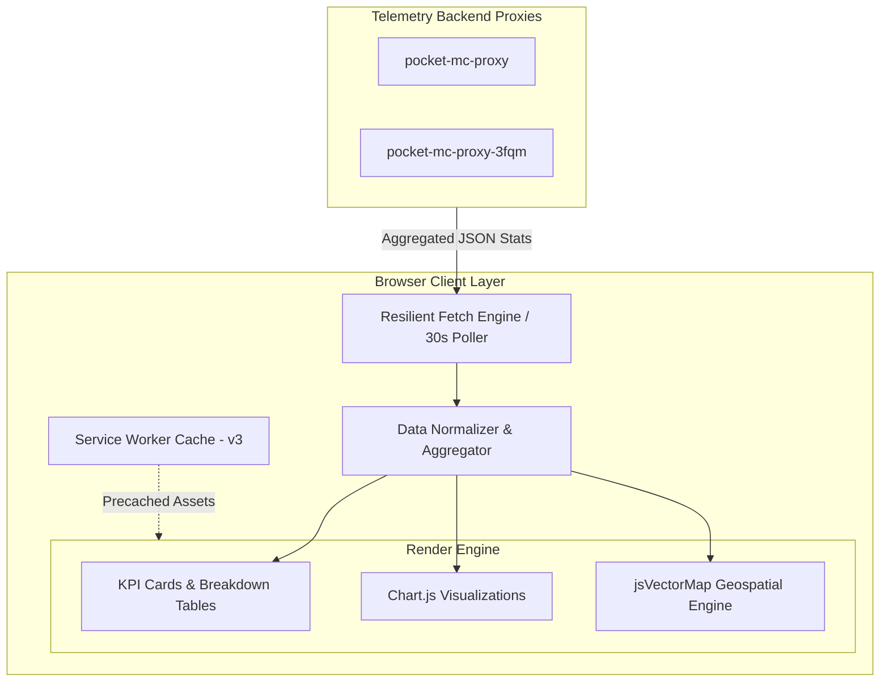

<div align="center">

# PocketMC Telemetry Dashboard

An interactive, real-time analytics dashboard and global geospatial monitor for PocketMC.

[](https://pocketmc.github.io/pocket-mc-telemetry/)
[](https://pocketmc.github.io/pocket-mc-website/)
[](manifest.json)
[](LICENSE)
[](index.html)

</div>

---

## Overview

The **PocketMC Telemetry Dashboard** delivers real-time, privacy-first usage metrics and global analytics for PocketMC installations, active clients, and live servers.

Built as a lightweight, high-performance static Progressive Web App (PWA), the dashboard operates without any build toolchain or heavy framework overhead, rendering rich visualizations directly in any modern browser.

```
+-------------------------------------------------------------------------+
| PocketMC Telemetry Dashboard                                            |
|                                                                         |
|  [ Total Installs: 77 ]    [ Active Users: 9 ]    [ Live Servers: 9 ]   |
|                                                                         |
|  +---------------------------+  +------------------------------------+  |
|  | Installation Analytics    |  | Active Client Distribution         |  |
|  | - Versions: 1.9.3, 1.9.4  |  | - Online vs AFK Users              |  |
|  | - Top Geos: US, ES, RO    |  | - Server Density Metrics           |  |
|  +---------------------------+  +------------------------------------+  |
|                                                                         |
|  +-------------------------------------------------------------------+  |
|  | Global Activity Map & Heatmap (Active Now + Registered Installs)    |  |
|  +-------------------------------------------------------------------+  |
+-------------------------------------------------------------------------+
```

---

## Key Features

### 1. Real-Time Telemetry & Insights
- **Installations & User Base:** Tracks total lifetime install volume, rolling 7-day active users (WAU), inactive users (dormant > 7 days), unique client version adoption, country reach, and average installs per country.
- **Active Clients:** Real-time visibility into open instances, actively engaged hosting users, idle/AFK clients, and calculated server density (users per server).
- **Server Health:** Global uptime monitoring, active running servers, and lifetime creation vs deletion lifecycle counts.
- **Engine Breakdown:** Real-time distribution across Bedrock (BDS), Fabric, Paper, NeoForge, and custom server types.

### 2. Interactive Global Geospatial Map
- **Dual-Marker Visualization:**
  - **Blue Pulsing Markers:** Represent live, active sessions currently communicating with telemetry nodes.
  - **Green Static Markers:** Indicate registered installations and historic regions with zero current live traffic.
- **Neutral Executive Canvas:** Clean vector landmass with high-contrast borders and rich interactive hover cards displaying country flags, active users, and total install counts.
- **Zoom-Aware Typography:** Vector country labels automatically fade in past a 2.0x zoom threshold to prevent visual clutter on mobile and desktop viewports.
- **Mobile-Optimized Touch:** Native gesture recognition supporting finger pinch-to-zoom, panning, and responsive bottom toast notifications on marker taps.

### 3. Dedicated Fullscreen Heatmap (`heatmap.html`)
- Dedicated standalone immersive view optimized for kiosk displays and operations monitoring.
- High-contrast visual palette tailored for ambient dashboard viewing.

### 4. Resilient Multi-Proxy Polling
- Automatically polls active telemetry proxies with configurable intervals (default: 30 seconds).
- Graceful degradation: in case of upstream network timeouts, previous valid metrics persist without UI flicker or disruptive error loops.
- Integrated request locking (`isFetching`) and abort controllers prevent concurrent race conditions.

### 5. Progressive Web App (PWA)
- Offline-ready asset caching powered by Service Worker (`sw.js`).
- Installable on desktop and mobile platforms with native standalone display mode and custom icons.

---

## Architecture & Data Flow



---

## Repository Structure

```
pocket-mc-telemetry/
|-- .github/
|   `-- workflows/
|       `-- deploy.yml          # Automated GitHub Pages CI/CD pipeline
|-- src/
|   |-- app.js                  # Core dashboard logic, poller, and map controller
|   |-- countries.js            # Global ISO-3166-1 coordinate and centroid dataset
|   |-- style.css               # Modern dark-zinc responsive styling
|   |-- heatmap.js              # Dedicated fullscreen heatmap controller
|   `-- heatmap.css             # Fullscreen heatmap overlay styling
|-- heatmap.html                # Standalone fullscreen global heatmap view
|-- icon.svg                    # Vector brand mark and PWA icon
|-- index.html                  # Main telemetry dashboard application
|-- manifest.json               # Web App Manifest for PWA installation
|-- sw.js                       # Service Worker caching and offline engine
|-- LICENSE                     # MIT License
`-- README.md                   # Project documentation
```

---

## Technical Stack

| Component | Technology | Description |
| :--- | :--- | :--- |
| **Markup & Structure** | HTML5 Semantic Web | Accessible structure with ARIA collapsible regions |
| **Styling** | CSS3 & Custom Properties | Responsive dark palette (`#050505` zinc theme) |
| **Logic** | Vanilla JavaScript (ES6+) | Dependency-free architecture with native DOM APIs |
| **Geospatial Engine** | jsVectorMap 1.7.0 | Lightweight vector map renderer with SVG paths |
| **Visual Charts** | Chart.js 4.4.4 | Bar graphs and distribution visualizers |
| **PWA & Offline** | Service Worker API | Static precaching and offline fallback |
| **Automation** | GitHub Actions | Continuous deployment to GitHub Pages |

---

## Local Development

Because this project is built as a pure static web application, no compilation, transpilation, or Node.js runtime is required.

### Prerequisites
Any local HTTP server (Python, Node, Caddy, Nginx, or VS Code Live Server).

### Quick Start

1. **Clone the repository:**
   ```bash
   git clone https://github.com/PocketMC/pocket-mc-telemetry.git
   cd pocket-mc-telemetry
   ```

2. **Start a local HTTP server:**
   
   Using Python 3:
   ```bash
   python -m http.server 8000
   ```

   Using Node (`npx serve`):
   ```bash
   npx serve .
   ```

   Using PHP:
   ```bash
   php -S localhost:8000
   ```

3. **Open in browser:**
   Navigate to `http://localhost:8000` (or `http://localhost:8000/heatmap.html` for the standalone heatmap).

> **Note on Protocol:** Avoid opening `index.html` via the direct `file:///` URI scheme. Browsers restrict Service Worker registration and asynchronous fetching under the file protocol.

---

## Configuration

Telemetry endpoint definitions and refresh intervals can be configured directly in [src/app.js](file:///d:/Projects/PocketMC/pocket-mc-telemetry/src/app.js) and [src/heatmap.js](file:///d:/Projects/PocketMC/pocket-mc-telemetry/src/heatmap.js):

```javascript
// Telemetry proxy endpoints (polled in parallel or fallback order)
const TELEMETRY_PROXIES = [
  "https://pocket-mc-proxy.onrender.com/api/telemetry/stats",
  "https://pocket-mc-proxy-3fqm.onrender.com/api/telemetry/stats"
];

// Polling interval in seconds
const REFRESH_INTERVAL = 30;
```

---

## Deployment

The project is pre-configured for automated static deployment via GitHub Actions in [.github/workflows/deploy.yml](file:///d:/Projects/PocketMC/pocket-mc-telemetry/.github/workflows/deploy.yml).

Every push to the `main` or `master` branch automatically deploys the latest static assets to the GitHub Pages environment.

For other static hosting providers (Cloudflare Pages, Vercel, Netlify):
- **Build Command:** *(leave empty)*
- **Output Directory:** `.` *(root)*

---

## Privacy & Telemetry Standards

The telemetry architecture operates under strict privacy principles:
- **Zero PII Collection:** No IP addresses, usernames, hardware identifiers, or personal data are stored or processed.
- **Granularity:** Location metrics are resolved exclusively at the country code level (ISO 3166-1 alpha-2). Marker placements on the map represent general geographic centroids, not precise physical coordinates.
- **Public Visibility:** All collected metrics are aggregated and rendered transparently for the community.

---

## License

This project is licensed under the **MIT License**. See the [LICENSE](file:///d:/Projects/PocketMC/pocket-mc-telemetry/LICENSE) file for complete details.
